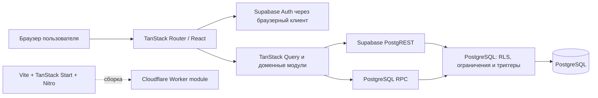
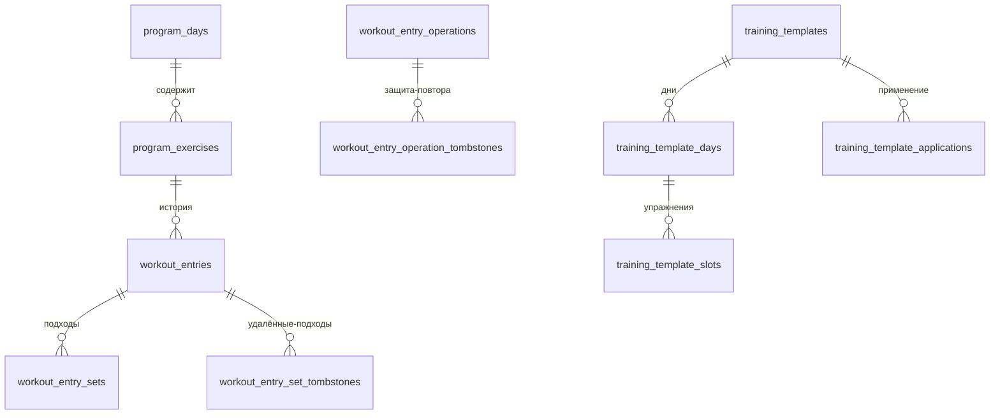

# Архитектура Progress Tracker

> Состояние исходников проверено 4 ноября 2026 года. Здесь описана реализация в репозитории. Наличие локальной миграции не подтверждает её применение к hosted Supabase, а Cloudflare-конфигурация не подтверждает факт развёртывания.

## Обзор

Progress Tracker — браузерное React-приложение для личных силовых тренировок. Клиентский код обращается к Supabase Auth, PostgREST и RPC. PostgreSQL отвечает за изоляцию строк, ограничения целостности и транзакционные доменные операции.

## Слои и границы

### UI и маршрутизация

- `src/routes/` содержит корневой layout, страницу входа и защищённую группу `_authenticated`.
- Защищённые маршруты работают с `ssr: false`; проверка сессии выполняется через Supabase Auth в браузере. `AccountBoundary` препятствует отображению кеша предыдущего аккаунта при смене пользователя.
- Корневой layout предоставляет Query Client, сессию, язык и тему. Локализация поддерживает русский и английский, темы — Light, Dark и System.
- `routeTree.gen.ts` — сгенерированное описание маршрутов; редактируйте исходные route-файлы.

### Клиентское состояние и доступ к данным

- `src/integrations/supabase/client.ts` создаёт браузерный Supabase JS client с сохранением и обновлением сессии и обёрткой storage для preview-среды.
- `src/lib/queries.ts` и функциональные модули используют PostgREST, пользовательские фильтры и ключи TanStack Query. Фильтры клиента нужны для корректных запросов, но границей безопасности остаются RLS и owner-checks на стороне базы.
- Мутации вызывают SQL RPC для операций, требующих атомарности или проверки доменных инвариантов.
- В репозитории есть server-only helpers, включая service-role helper, но проверенный пользовательский data path проходит через браузерный клиент. Не импортируйте секретный helper в клиентские модули.
- TanStack Start/Nitro присутствуют в сборке. На момент проверки в `src/` не найдено вызовов `createServerFn`, пользовательских API routes или server functions; не описывайте их как текущую границу данных.

### Доменная логика

- `src/lib/workout.ts` содержит чистые расчёты метрик и сравнений.
- UI и запросы сгруппированы вокруг программы, тренировок, истории, библиотеки и аналитики; общего отдельного серверного backend-service слоя нет.
- Черновик тренировки сохраняется локально для восстановления ввода. Это не офлайн-синхронизация: авторизация и обмен данными требуют сети.

### Данные и PostgreSQL

Фактический DDL, функции и триггеры находятся в `drizzle/migrations/*.sql`. `drizzle/schema.ts` намеренно пуст, Drizzle ORM не участвует в runtime-запросах. `drizzle.config.ts` и Drizzle Kit обслуживают миграционный workflow, а не источник runtime-модели.

Основные таблицы включают `program_days`, `program_exercises`, `workout_entries`, `workout_entry_sets`, таблицы операций и tombstones, а также `training_exercise_catalog` и таблицы опубликованных шаблонов. Пользовательские строки связаны с `user_id`; миграции определяют RLS, owner policies, внешние ключи, ограничения и RPC.

Ключевые свойства модели:

- У пользователя от одного до семи активных дней. Изменение порядка и состава сериализуется функциями базы.
- Запись упражнения сохраняет историческое имя дня (`day_name`) и ссылку `day_id`; серверная логика проверяет владельца и активность связей.
- Подходы хранятся отдельно с позицией, весом, повторами, необязательным RIR, типом `working`/`warmup` и типом нагрузки `external`/`bodyweight`.
- Совместимые legacy-поля записи и legacy snapshot подходов сохраняют прежние данные при переходе к модели по подходам.
- UUID операции делает сохранение записи идемпотентным; ledger и tombstones блокируют повторное применение изменённой или удалённой операции.
- Редактирование сохранённого подхода использует `edit_workout_entry_set`: `expected_revision` и отдельный operation UUID. Revision-конфликт сохраняет ввод в редакторе; точный повтор возвращает прежний результат, не применяя правку поверх более новой. Для этого нужна forward-миграция `20261105010000_workout_set_edit_revisions.sql`; старый update RPC без revision закрывается для browser roles.
- Release gate проверяет исходный operation snapshot отдельно от текущих подходов: допустимые edit/add/delete/reorder не обязаны сохранять равенство legacy-полям записи. Неизменённые legacy-подходы сопоставляются со снимком по ID; отсутствие исходного подхода требует owner-scoped tombstone.
- Архивирование сохраняет данные. Финальное удаление доступно для архивных объектов через owner-checked RPC; удаление аккаунта отдельным lifecycle не реализовано.

Подробные ограничения и порядок миграций см. в `DATABASE-RELEASE-CONTRACT-RU.md`, `ARCHIVE-DELETION-RU.md` и SQL-тестах. Локальные PGlite проверки не подтверждают конфигурацию удалённого Supabase Auth, PostgREST или RLS.

## Потоки запросов

1. Маршрут получает текущего пользователя через Supabase Auth.
2. Query-функция читает пользовательские данные через браузерный клиент Supabase; TanStack Query управляет ключом, кешем и повторным чтением.
3. PostgreSQL применяет RLS и ограничения к PostgREST-запросу.
4. Составные изменения вызывают RPC, которая проверяет владельца и инварианты в одной транзакции.
5. После успешной мутации UI обновляет или инвалидирует относящийся к пользователю кеш.

Точные детали конкретной мутации нужно сверять в её исходнике и SQL, а не выводить из этой общей схемы.

## Сборка и окружения

- `vite.config.ts` подключает TanStack Start и Nitro с Cloudflare Worker module target. `preview` запускает Wrangler для локальной проверки собранного артефакта.
- `supabase/config.toml` не выбирает hosted project по умолчанию. Для операций с hosted базой требуется явная проверка целевого project ref и отдельное разрешение задачи.
- CI направляет тесты на локальные mock-сервисы и синтетические URL `.invalid`. Workflow `quality.yml` выполняет качество кода, unit/database/contracts, build/security и четыре Playwright shard; агрегированный check зависит от них. Событийная маршрутизация может пропустить дублирующий push-run при открытом PR, поэтому проверяйте PR-run на точном SHA.
- В репозитории не обнаружен workflow deployment. Это не доказывает, что приложение нигде не развёрнуто.

## Тестирование

| Уровень                   | Проверяет                                                                         | Ограничение                                                                  |
| ------------------------- | --------------------------------------------------------------------------------- | ---------------------------------------------------------------------------- |
| Vitest + jsdom            | UI и клиентская логика                                                            | Не подтверждает удалённый backend.                                           |
| Node test runner + PGlite | SQL migrations, роли, `auth.uid()`, ограничения и RPC в локальной эмуляции        | Не эквивалентен hosted Supabase Auth/PostgREST и production-данным.          |
| Playwright                | браузерные сценарии Chromium/WebKit с мобильным viewport и тестовой конфигурацией | Staging-конфигурация отдельна; обычный CI использует локальный mock backend. |
| GitHub Actions            | Полный регрессионный набор для SHA PR                                             | PASS применим только к проверенному SHA и завершённым обязательным checks.   |

Доступные команды см. в `package.json`; конфигурации — `vitest.config.ts`, `playwright.config.ts`, `playwright.staging.config.ts` и `.github/workflows/quality.yml`.

Межсоединительная конкуренция отдельно проверяется `bun run test:concurrency` на disposable PostgreSQL 18.6. Три различных backend PID используются для двух транзакций и наблюдателя `pg_blocking_pids`: проверяются реальное ожидание блокировки, create retry, stale edit SQLSTATE 40001 и повтор старой операции после новой правки. CI использует официальный образ `library/postgres:18.6` по digest `sha256:bd5dfa494a5a259704365813dbfa5fa6b3e69be7348d43b547f540c730478583` ([provenance](https://hub.docker.com/v2/repositories/library/postgres/tags/18.6)). Только явно названная passwordless loopback fixture DB допускается как control endpoint; каждый запуск создаёт новую синтетическую базу. Hosted URL отклоняется до соединения. Локальные fixture DB сохраняются до отдельной очистки, CI service исчезает вместе с job. Проверки PostgreSQL 18 не подтверждают версии/настройки hosted PostgreSQL и не заменяют отдельную rehearsal.

## Расширение архитектуры

- Новые персональные данные должны получать владельца, RLS policies и серверные проверки; сначала изучите существующие миграции и тестовые контракты.
- Новые атомарные операции и межстрочные инварианты реализуйте в SQL RPC с проверками владельца, повторов и удаления, когда это применимо.
- Доменную математику держите чистой и покрывайте целевыми тестами; не переносите проверки безопасности только в UI.
- Перед описанием server functions, полноценного offline, account deletion или deployment подтверждайте реализацию фактическими исходниками и конфигурацией.

## Источники для актуализации

Проверяйте `package.json`, `vite.config.ts`, `src/start.ts`, `src/server.ts`, `src/routes/`, `src/integrations/supabase/`, `src/lib/`, `drizzle/migrations/`, тестовые конфигурации и workflows. Справочник продукта и ссылок находится в [`PROJECT_CONTEXT.md`](PROJECT_CONTEXT.md).
