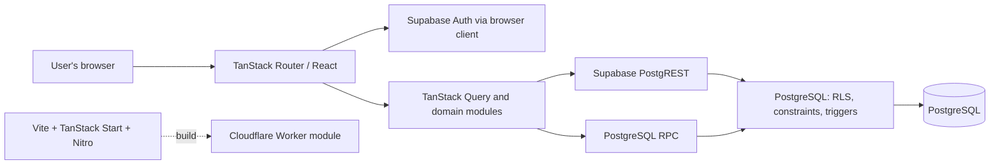

# Progress Tracker architecture

> Source review date: 4 November 2026. This document describes the repository implementation. A local migration does not prove that it has been applied to hosted Supabase, and Cloudflare configuration does not prove a deployment exists.

## Overview

Progress Tracker is a browser-based React application for personal strength training. The browser communicates with Supabase Auth, PostgREST, and database RPCs. PostgreSQL enforces row isolation, integrity constraints, and transactional domain operations.

## Layers and boundaries

### UI and routing

- `src/routes/` contains the root layout, sign-in page, and the authenticated route group.
- Authenticated routes use `ssr: false`; session checks use Supabase Auth in the browser. `AccountBoundary` prevents cached data from a previous account from appearing after an account change.
- Unhandled SSR errors return generic HTML with `x-pt-error-id`. The server records only `ssr_failure`, fixed `boundary`/`kind` values, and a random ID. It does not record message, stack, cause, URL, headers, or user data. When h3 has swallowed the response error, `framework_swallowed` does not claim to be the original exception. Platform log retention and alerts require separate verification.
- The root layout provides the Query Client, session, locale, and theme. The UI supports English and Russian, and Light, Dark, and System themes.
- `routeTree.gen.ts` is generated. Edit route source files instead.

### Client state and data access

- `src/integrations/supabase/client.ts` creates the browser Supabase JS client with session persistence and refresh, plus a storage wrapper for preview environments.
- `src/lib/queries.ts` and feature modules use PostgREST, user-scoped filters, and TanStack Query keys. Client filters shape requests; RLS and database owner checks remain the security boundary.
- Mutations use SQL RPCs for operations that need atomicity or domain invariant checks.
- Server-only helpers, including a service-role helper, exist in the repository. The inspected user data path uses the browser client. Never import a secret helper into client modules.
- TanStack Start/Nitro are part of the build. The reviewed `src/` tree contained no `createServerFn`, custom API routes, or server functions; do not describe them as the current data boundary.

### Domain logic

- `src/lib/workout.ts` contains pure metric and comparison calculations.
- UI and queries are organized around programs, workouts, history, the exercise library, and analytics. There is no separate general-purpose backend service layer.
- A workout draft is saved locally for input recovery. This is not offline synchronization; sign-in and database access require a network connection.

### Data and PostgreSQL

The actual DDL, functions, and triggers are in `drizzle/migrations/*.sql`. `drizzle/schema.ts` is intentionally empty, and Drizzle ORM is not used for runtime queries. `drizzle.config.ts` and Drizzle Kit support migration workflows; they do not define the runtime data model.

Primary tables include `program_days`, `program_exercises`, `workout_entries`, `workout_entry_sets`, operation and tombstone tables, `training_exercise_catalog`, and published-template tables. User-owned rows use `user_id`; migrations define RLS, owner policies, foreign keys, constraints, and RPCs.

Key model properties:

- Days and exercises have revisions. Semantic browser PATCH requests use compare-and-swap (CAS); SQL guards reject unconditional or stale changes, and reorder increments revisions. Editors do not automatically rebase. See [ADR 0006](DECISIONS/0006-program-edit-revisions.md).
- Each user has one to seven active training days. Database functions serialize changes to membership and order.
- Workout entries preserve the historical day name (`day_name`) and `day_id`; server-side logic checks ownership and active relationships.
- Sets are stored separately with position, weight, reps, optional RIR, `working`/`warmup` type, and `external`/`bodyweight` load type.
- Legacy entry fields and legacy set snapshots preserve earlier data during the move to per-set records.
- A stable operation UUID makes workout saves idempotent. Ledgers and tombstones prevent changed or deleted operations from being replayed.
- Editing a saved set uses `edit_workout_entry_set`, an `expected_revision`, and a separate operation UUID. Conflicts preserve editor input; exact retries return the prior result without overwriting newer sets. This behavior requires `20261105010000_workout_set_edit_revisions.sql`. The older update RPC without revision is closed to browser roles.
- The release gate validates the original operation snapshot separately from current sets, so valid edits/adds/deletes/reorders need not keep legacy entry fields equal. Unchanged legacy sets are matched by ID; removal of an original set requires an owner-scoped tombstone.
- Archiving preserves data. Final deletion of archived objects uses owner-checked RPCs. Account deletion is a separate, unimplemented lifecycle.

See [the database release contract](DATABASE-RELEASE-CONTRACT.md), [archive and deletion guidance](ARCHIVE-DELETION.md), and SQL tests for constraints and migration order. Local PGlite checks do not prove remote Supabase Auth, PostgREST, or RLS configuration.

## Request flow

1. The route obtains the current user through Supabase Auth.
2. A query function reads user data through the browser Supabase client; TanStack Query manages cache keys and refetching.
3. PostgreSQL applies RLS and constraints to PostgREST requests.
4. Multi-row mutations call an RPC that checks ownership and invariants in a transaction.
5. On success, the UI updates or invalidates the relevant user-scoped cache.

Verify individual mutation behavior in its source and SQL instead of inferring details from this overview.

## Build and environments

- `vite.config.ts` configures TanStack Start and Nitro for a Cloudflare Worker module target. `preview` runs Wrangler for local inspection of the built artifact.
- Before Vite compilation and public-client creation, the app checks that a publishable key has the `sb_publishable_*` form or is a legacy JWT with `role=anon`. Secret/service-role and unknown values are rejected without printing the value. This does not validate key signatures or validity. The server-only service-role helper remains a separate trusted path.
- `supabase/config.toml` does not select a hosted project by default. Hosted database operations require explicit project-ref verification and separate task authorization.
- CI directs tests to local mocks and synthetic `.invalid` URLs. `quality.yml` runs code quality, unit/database/contracts, build/security, and four Playwright shards; the aggregate check depends on these jobs. Event routing may skip a duplicate push run when a PR is open, so verify the PR run against the exact SHA.
- `bun run test:worker` runs one Chromium auth → program → save → records/reload scenario against `.output/server/wrangler.json` through local `wrangler dev --local`. It runs after the existing build in Build & Security; four dev-server shards remain. The mock intercepts Supabase `.invalid`; external requests are blocked and service workers disabled. This checks the production artifact, not hosted Auth/database or deployment.
- No deployment workflow was found in the repository. That does not prove the app is not deployed elsewhere.

## Testing

| Level                     | Covers                                                                        | Limitation                                                           |
| ------------------------- | ----------------------------------------------------------------------------- | -------------------------------------------------------------------- |
| Vitest + jsdom            | UI and client logic                                                           | Does not verify a remote backend.                                    |
| Node test runner + PGlite | SQL migrations, roles, `auth.uid()`, constraints, and RPCs in local emulation | Not equivalent to hosted Supabase Auth/PostgREST or production data. |
| Playwright                | Chromium/WebKit browser flows and mobile viewports                            | Ordinary CI uses a local mock backend; staging is separate.          |
| GitHub Actions            | Regression checks for a PR SHA                                                | A pass applies only to the tested SHA and completed required checks. |

Commands are listed in `package.json`; test configurations include `vitest.config.ts`, `playwright.config.ts`, `playwright.staging.config.ts`, and `.github/workflows/quality.yml`.

Cross-connection concurrency is separately checked by `bun run test:concurrency` against disposable PostgreSQL 18.6. Three backend PIDs are used for two transactions and a `pg_blocking_pids` observer. The check covers real lock waiting, create retry, stale-edit SQLSTATE 40001, and replaying an old operation after a newer edit. CI pins the official `library/postgres:18.6` image by digest. Only an explicitly named passwordless loopback fixture database may be used as the control endpoint; each run creates a new synthetic database. Hosted URLs are rejected before connecting. Local fixtures remain until explicitly cleaned up; the CI service ends with its job. PostgreSQL 18 checks do not establish hosted PostgreSQL versions or settings and do not replace a separate rehearsal.

## Extending the architecture

- Personal data needs an owner, RLS policies, and server-side checks. Review existing migrations and test contracts first.
- Implement atomic operations and cross-row invariants in SQL RPCs with ownership, replay, and deletion checks where applicable.
- Keep domain calculations pure and test them directly; do not move security checks exclusively into the UI.
- Verify source and configuration before documenting server functions, full offline support, account deletion, or deployment.

For updates, inspect `package.json`, `vite.config.ts`, `src/start.ts`, `src/server.ts`, `src/routes/`, `src/integrations/supabase/`, `src/lib/`, `drizzle/migrations/`, test configuration, and workflows. See [the documentation index](README.md).
